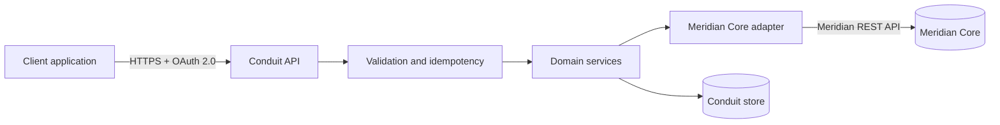
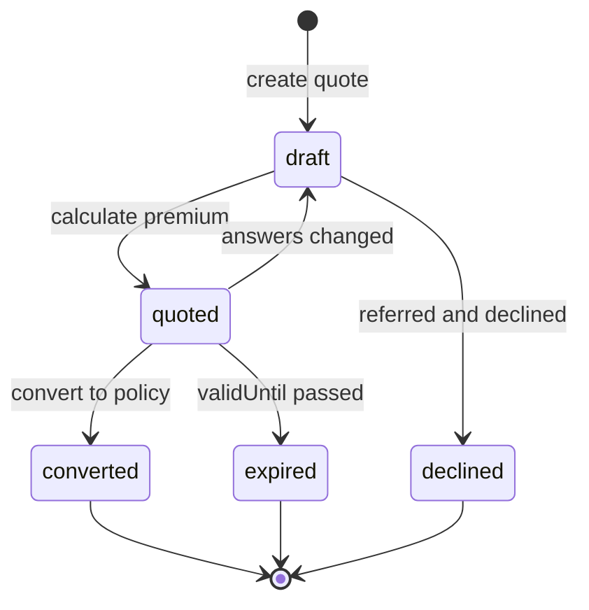

# Architecture

Conduit has three responsibilities: expose a stable API, translate between that API and Meridian Core, and protect the backend.

## Components

**Conduit API.** The public contract described in the [API reference](../api/conduit-integration-api). It authenticates the caller, checks scopes and rejects malformed requests.

**Validation and idempotency.** Every state-changing request carries an `Idempotency-Key`. Conduit stores the outcome so a retry returns the original result instead of repeating the action. See [Idempotency and errors](idempotency-and-errors.md).

**Domain services.** One service for each area: clients, quote journeys, quotes, premiums, policies and tasks. They contain the rules that are the same whichever channel is calling, such as quote expiry and the quote status lifecycle.

**Meridian Core adapter.** The only component that knows how Meridian Core works. It maps Conduit's model to Meridian's API, handles timeouts and retries, and converts Meridian's errors into Conduit error codes. See [Meridian Core](meridian-core.md).

**Conduit store.** Holds only what Meridian Core does not: idempotency records, a cache of journey definitions, and a reference table linking quotes to Meridian Core identifiers. Clients, policies and premiums are owned by Meridian Core.

## Design principles

- **Channel agnostic.** There are no endpoints or fields tied to a particular user interface. Callers are identified by their OAuth client and scopes, not by the kind of application they are.
- **Backend owns the data.** Conduit is not a system of record. If Conduit's store were wiped, no insurance data would be lost.
- **Product-driven forms.** Quote journey definitions come from Meridian Core's product configuration, so product changes do not need client releases.
- **Fail visibly.** Backend failures return `502` with a request id. Conduit never invents a premium or a policy status.

## Quote lifecycle

