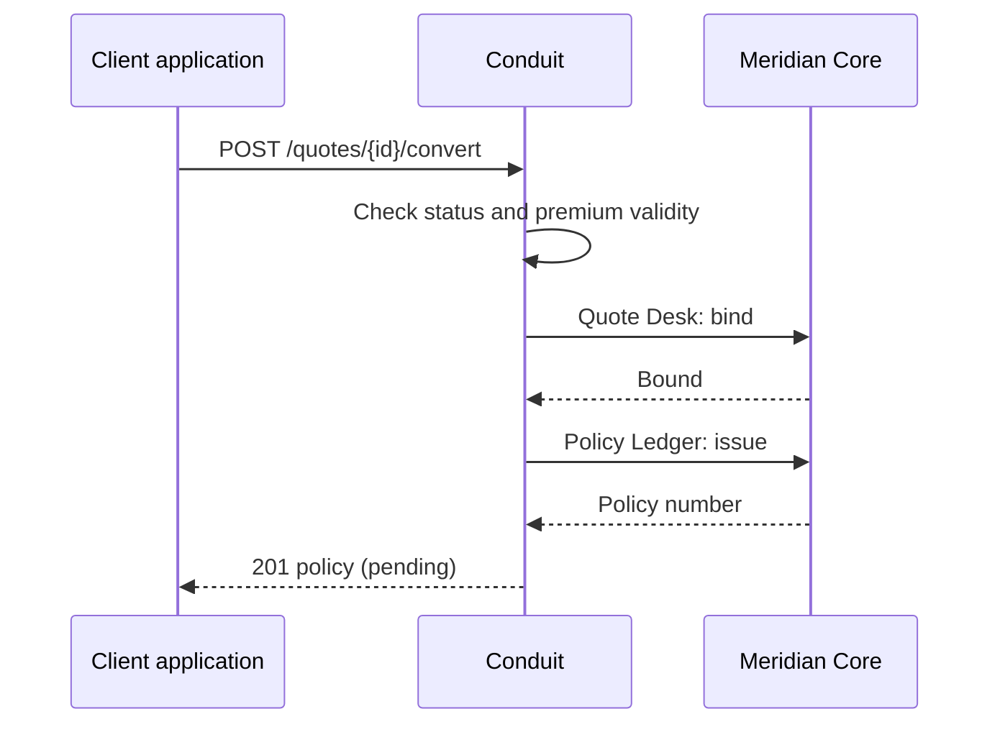

# Converting a quote to a policy

Conversion binds a `quoted` quote into a policy in Meridian Core.

## Before you convert

- The quote status is `quoted`, and `premium.validUntil` is in the future.
- The customer has accepted the terms, and you have collected payment details with your own payment provider.
- You have a payment token from that provider. Conduit never receives card details.

## Convert

```bash
curl -X POST https://conduit.example.com/v1/quotes/qte_8f2a1c/convert \
  -H "Authorization: Bearer $ACCESS_TOKEN" \
  -H "Idempotency-Key: $(uuidgen)" \
  -H "Content-Type: application/json" \
  -d '{
    "startDate": "2026-03-01",
    "paymentFrequency": "monthly",
    "paymentToken": "tok_9c1d...",
    "acceptedTerms": true
  }'
```

```json
{
  "id": "pol_77b3",
  "policyNumber": "MC-2026-004417",
  "productCode": "motor-comprehensive",
  "clientId": "cli_2f7a",
  "quoteId": "qte_8f2a1c",
  "status": "pending",
  "startDate": "2026-03-01",
  "endDate": "2027-02-28",
  "documents": []
}
```

The policy starts as `pending` and becomes `in_force` on its start date once the first payment is confirmed. Documents such as the policy schedule can take a few seconds to appear, so read the policy again if `documents` is empty.



## Failures and retries

| Code | Status | What to do |
| --- | --- | --- |
| `quote_expired` | `422` | Calculate the premium again, show the new price, and ask the customer to confirm. |
| `quote_not_priced` | `422` | Calculate the premium first. |
| `quote_already_converted` | `409` | The quote already has a policy. Read `policyId` from the quote. |
| `backend_unavailable` | `502` | Retry with the **same** `Idempotency-Key`. |

:::warning
After a `502` or a timeout, always retry with the same `Idempotency-Key`. Meridian Core may already have issued the policy, and the key is what stops a second policy being created.
:::

## Related endpoints

- [`POST /quotes/{quoteId}/convert`](../api/convert-quote)
- [`GET /policies/{policyId}`](../api/get-policy)
