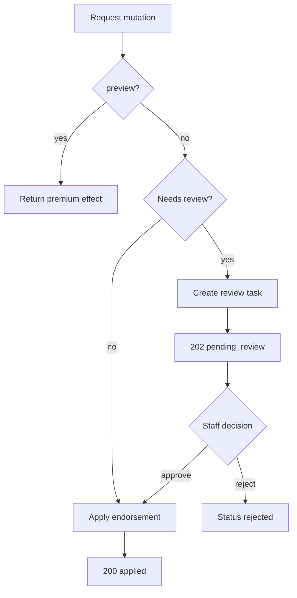

# Policy mutations

A mutation is a change to an in-force policy. Conduit turns it into an endorsement in Meridian Core's Policy Ledger and reports the effect on the premium.

## Mutation types

| `type` | Typical `changes` | Notes |
| --- | --- | --- |
| `change_address` | `address` | May change the premium. |
| `add_driver` | `driver` (name, date of birth, licence details) | Often needs review. |
| `remove_driver` | `driverId` | |
| `change_vehicle` | `vehicle` (registration, value) | Often needs review. |
| `change_cover` | `optionalCovers` to add or remove | |
| `change_excess` | `excess` | |
| `cancel` | none, but `reason` is required | Refunds are calculated pro rata. |

## Preview first

Set `preview: true` to see the premium effect without changing anything.

```bash
curl -X POST https://conduit.example.com/v1/policies/pol_77b3/mutations \
  -H "Authorization: Bearer $ACCESS_TOKEN" \
  -H "Idempotency-Key: $(uuidgen)" \
  -H "Content-Type: application/json" \
  -d '{
    "type": "change_address",
    "effectiveDate": "2026-04-01",
    "preview": true,
    "changes": {
      "address": {
        "line1": "4 Mill Lane",
        "city": "Bath",
        "postalCode": "BA1 2XY",
        "country": "GB"
      }
    }
  }'
```

```json
{
  "id": "mut_5d21",
  "policyId": "pol_77b3",
  "type": "change_address",
  "status": "preview",
  "effectiveDate": "2026-04-01",
  "premiumChange": { "amount": "18.40", "currency": "GBP" }
}
```

`premiumChange` is signed. A positive amount is an extra charge, and a negative amount is a refund.

## Apply

Send the same request with `preview` omitted or `false`. Conduit applies the change, or hands it to a person.

| Response | `status` | Meaning |
| --- | --- | --- |
| `200` | `applied` | The change is in force from `effectiveDate`. |
| `202` | `pending_review` | Underwriting must review it. A `taskId` is returned. |



## Tracking a pending mutation

Poll `GET /policies/{policyId}/mutations/{mutationId}` until `status` is `applied` or `rejected`. A rejected mutation includes a `rejectionReason`. Use `GET /policies/{policyId}/mutations` to list the policy's history, newest first.

## Rules

- Mutations are only allowed on policies that are `in_force`. Otherwise Conduit returns `422` with `mutation_not_allowed`.
- `effectiveDate` cannot be earlier than the policy start date, and may be limited by the product's backdating rules.
- A second mutation that overlaps a pending one returns `409`.

## Related endpoints

- [`POST /policies/{policyId}/mutations`](../api/create-policy-mutation)
- [`GET /policies/{policyId}/mutations`](../api/list-policy-mutations)
- [`GET /policies/{policyId}/mutations/{mutationId}`](../api/get-policy-mutation)
