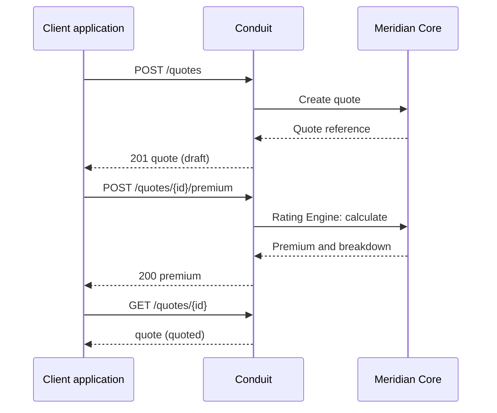

# Quotes and premiums

## Create a quote

A quote ties a client, a product and the journey answers together.

```bash
curl -X POST https://conduit.example.com/v1/quotes \
  -H "Authorization: Bearer $ACCESS_TOKEN" \
  -H "Idempotency-Key: $(uuidgen)" \
  -H "Content-Type: application/json" \
  -d '{
    "productCode": "motor-comprehensive",
    "clientId": "cli_2f7a",
    "reference": "web-84211",
    "answers": {
      "vehicle.registration": "AB12 CDE",
      "vehicle.value": 18500,
      "driver.dateOfBirth": "1988-04-12",
      "driver.hasConvictions": false,
      "cover.startDate": "2026-03-01"
    }
  }'
```

The quote starts as `draft`. If the answers are complete, Conduit also calculates the premium and returns the quote as `quoted`. Your `reference` comes back unchanged, so you can match the quote to your own records.

## Premium calculation

Premiums are calculated by Meridian Core's Rating Engine. Conduit sends the answers, the chosen options and the product, and returns the result with a breakdown.

```bash
curl -X POST https://conduit.example.com/v1/quotes/qte_8f2a1c/premium \
  -H "Authorization: Bearer $ACCESS_TOKEN" \
  -H "Idempotency-Key: $(uuidgen)" \
  -H "Content-Type: application/json" \
  -d '{
    "optionalCovers": ["legal-expenses"],
    "paymentFrequency": "monthly",
    "excess": { "amount": "250.00", "currency": "GBP" }
  }'
```

```json
{
  "total": { "amount": "486.00", "currency": "GBP" },
  "paymentFrequency": "monthly",
  "instalment": { "amount": "40.50", "currency": "GBP" },
  "breakdown": [
    { "code": "base", "label": "Base premium", "amount": { "amount": "412.50", "currency": "GBP" } },
    { "code": "legal-expenses", "label": "Legal expenses", "amount": { "amount": "28.00", "currency": "GBP" } },
    { "code": "tax", "label": "Insurance premium tax", "amount": { "amount": "45.50", "currency": "GBP" } }
  ],
  "validUntil": "2026-02-28T23:59:59Z",
  "ratingVersion": "R-2026.02"
}
```

Show `breakdown` lines rather than only the total, so customers can see what each optional cover costs.

### Validity

A premium is only valid until `validUntil`. After that the quote moves to `expired`, and converting it fails with `quote_expired`. Calculate the premium again to get a fresh price. It may differ, because rating tables change.

### Changing answers

`PATCH /quotes/{quoteId}` merges new answers into a `draft` or `quoted` quote. Any existing premium is discarded and the quote returns to `draft`, because the old price no longer applies. Calculate the premium again afterwards.



## Premium without a quote

For "from" prices and comparison screens, price a set of answers without creating anything:

```bash
curl -X POST https://conduit.example.com/v1/premium-calculations \
  -H "Authorization: Bearer $ACCESS_TOKEN" \
  -H "Content-Type: application/json" \
  -d '{
    "productCode": "motor-comprehensive",
    "answers": { "vehicle.value": 18500, "driver.dateOfBirth": "1988-04-12" }
  }'
```

Nothing is stored, so the result cannot be converted to a policy. Create a quote when the customer wants to continue.

## Related endpoints

- [`POST /quotes`](../api/create-quote)
- [`PATCH /quotes/{quoteId}`](../api/update-quote)
- [`POST /quotes/{quoteId}/premium`](../api/calculate-quote-premium)
- [`GET /quotes/{quoteId}/premium`](../api/get-quote-premium)
- [`POST /premium-calculations`](../api/calculate-premium)
